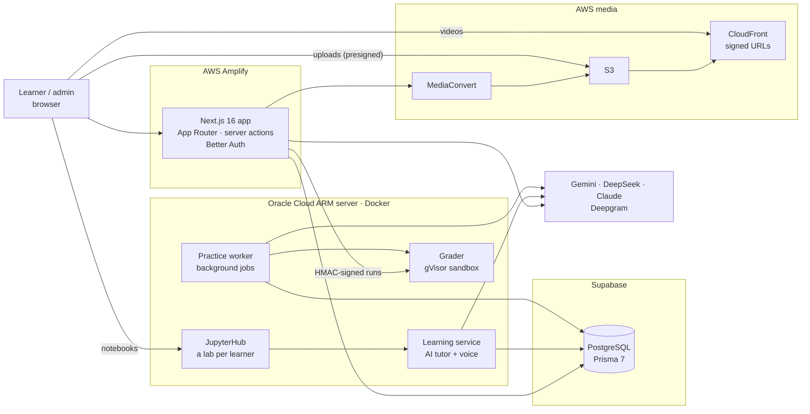

<div align="center">


# Academia del Código

**An AI-powered learning platform that teaches developers to build LLM applications with LangChain and LangGraph:
in-browser notebooks, an AI tutor you can talk to, and adaptive daily practice whose AI-written exercises are proven
correct before any learner sees them.**

[**Live site → academiadelcodigo.com**](https://academiadelcodigo.com)


</div>

---

## At a glance

| | |
|---|---|
| **What** | A bilingual (Spanish / English) learning platform, live in production, with a 129-lesson course, *Modern LangChain & LangGraph Mastery*, and 700+ practice skills. |
| **Built by** | One engineer, end to end: product, front end, back end, AI systems, infrastructure on AWS and a self-managed ARM server. |
| **Scale of the codebase** | ~32,000 lines of TypeScript, Python and SQL · 46 data models · 18 migrations · since November 2025. |
| **Runs on** | Next.js on AWS Amplify, PostgreSQL on Supabase, media on S3 + CloudFront + MediaConvert, and a Docker lab (JupyterHub, a code sandbox and background workers) on an Oracle Cloud ARM server. |

## Why it's interesting

- **AI content you can trust.** Every practice exercise an AI writes is *proven* before learners see it: code tasks run
  in a sandbox (the reference solution must pass its tests and a deliberately wrong one must fail), and questions are
  answered blind by a second model from another provider. A task that fails its proof goes back to its writer with the
  sandbox's exact output and is repaired, up to twice, before it's rejected.
- **Production-grade reliability on serverless.** Amplify kills any request after 28 seconds, so long jobs (writing
  2,500 exercises takes hours) run on a background worker with a job queue in Postgres: resumable after crashes,
  retried with back-off, stoppable from the admin page, with live progress and a problem list.
- **Safe execution of untrusted code.** Learner code runs in throwaway containers under gVisor: no network, read-only
  filesystem, dropped capabilities, memory, CPU, process and time limits, and HMAC-signed requests.
- **Multi-provider AI with graceful degradation.** Gemini, DeepSeek and Claude in ordered fallback chains with
  per-model timeouts, cool-downs after failures, daily quotas, structured outputs, streaming, and per-call cost
  tracing.
- **Learning science, not just content.** Spaced, adaptive practice (FSRS memory model) over a prerequisite skill graph;
  when a learner fails a skill twice, a model diagnoses which prerequisite is missing and the platform probes it.
- **Voice.** Learners talk to the tutor and hear it answer, with streaming speech-to-text and text-to-speech (Deepgram).

## Product tour

### For learners

- **Lessons with a runnable notebook** — each lesson's Jupyter notebook opens inside the page, in the learner's own lab
  (JupyterHub, one container per learner), with progress tracked per lesson.
- **An AI tutor beside the notebook** — a JupyterLab extension that finds the exact step a learner is stuck on, clears a
  missing prerequisite on the way, remembers each learner across sessions, and talks by voice.
- **Daily practice** — a few minutes a day of questions and code tasks chosen by the learner's memory and ability per
  skill; code answers are graded by real tests in the sandbox, with AI hints that never give the answer away.
- **A Python scratchbook** — Python beside every exercise (a calculator, a place to test an idea), run in the sandbox,
  with an AI that explains the learner's code and errors without solving the task.
- **Lesson videos** — a playlist per lesson, one video per skill, in a custom player: English or Spanish captions,
  speed, a searchable transcript, keyboard shortcuts, picture in picture, no download menu.
- **The Python guide** — every Python construct the course uses, with editable, runnable examples, linked from lessons
  and from the scratchbook's own code.
- **Coding challenges** with an in-browser editor and AI explanations.

### For admins

- **Practice skill graph** — draft each lesson's skills and prerequisites with a model, review, approve and publish
  versioned graphs.
- **Task writing at scale** — one click writes and proves every missing exercise as a background job; a task finder
  searches every task's words in both languages, with each task's success rate to spot weak questions.
- **Video pipeline** — browser uploads straight to S3 (presigned), encoding on MediaConvert with live progress,
  captions generated automatically (English transcribed by Deepgram, Spanish translated line for line by an LLM),
  custom posters, and a per-lesson brief that feeds an AI video studio.
- **Lab access** and **challenges** management.

## Architecture



- **The web app** (Next.js on Amplify) serves every page and runs short work in server actions, each kept inside a
  shared request budget below Amplify's limit.
- **The lab** (Docker Compose on an ARM server) runs what can't live in a 28-second request: learners' notebooks, the
  tutor's backend, the code sandbox and the practice worker. Its services are bundled from this repository with esbuild
  and share the app's code (`lib/`).
- **Media** never passes through the app: browsers upload to S3 with presigned URLs, MediaConvert encodes, and
  learners stream through CloudFront with short-lived signed URLs.

## Engineering decisions worth a look

| Problem | Approach | Where |
|---|---|---|
| AI-written exercises can be wrong | Prove each one: run code in the sandbox (reference passes, wrong versions fail) or have a second provider answer blind; repair from the sandbox's real output; keep rejected candidates with their reason | `lib/practice/tasks.ts` |
| Serverless requests die at 28 s | A shared request budget; long work moved to a Postgres-backed job queue and a worker with retries, back-off, crash recovery and graceful shutdown | `lib/request-budget.ts`, `lib/practice/jobs.ts`, `services/practice-worker` |
| Running learners' code safely | Throwaway containers under gVisor, no network, read-only, capped resources; results returned behind a per-run nonce so printed text can't fake a pass | `infra/lab/grader` |
| Free AI tiers are flaky | Ordered model chains with deadlines, cool-downs, quotas and fallbacks across providers; every call traced with its cost | `lib/ai/gemini.ts` |
| Amplify denies `iam:PassRole` to its compute role | Found the cause in CloudTrail (Amplify's session policy), then chained into a narrow encoder role so MediaConvert jobs can start | `infra/media/template.yaml`, `lib/media-aws.ts` |
| Captions in two languages | Deepgram transcribes the audio (an audio-only rendition, ~3 MB, sent as bytes); an LLM translates cue by cue so both tracks share timings | `lib/captions.ts` |
| Spaced practice that adapts | FSRS memory per skill and learner over a prerequisite graph, as pure functions of a replayable log; diagnoses probe missing prerequisites | `docs/practice.md`, `lib/practice/` |
| Video that can't be easily downloaded | A custom player: own controls, captions drawn by the player, no native menu, signed URLs that expire | `components/courses/video-player/` |

## Tech stack

| Area | Technologies |
|---|---|
| Front end | Next.js 16 (App Router), React 19, TypeScript, Tailwind CSS 4, Radix UI, Monaco editor, React Markdown |
| Back end | Next.js server actions, Prisma 7 (driver adapter on `pg`), PostgreSQL (Supabase), Better Auth (Google sign-in), Zod |
| AI | Google Gemini, DeepSeek, Anthropic Claude (structured outputs, streaming, fallbacks), Deepgram (speech-to-text, text-to-speech) |
| Learning engine | `@intellectif/lk-core`, `lk-react`, `lk-practice` (interactive activities, interactive video, FSRS-based practice planning) |
| Infrastructure | AWS Amplify, S3, CloudFront, MediaConvert, CloudFormation, IAM; Docker Compose, JupyterHub, gVisor, nginx on Oracle Cloud (ARM64) |
| Tooling | pnpm, esbuild, tsx, ESLint |

## Repository layout

```
app/                 Pages and routes (App Router): courses, lessons, practice, Python guide, challenges, admin
actions/             Server actions: the API the pages call
components/          UI: lesson workspace, video player, practice, scratchbook, admin tools
lib/                 Domain logic shared by the app and the lab services
  ai/                  Model chains, providers, quotas
  practice/            Skill graph, task writing and proofs, jobs, diagnoses, hints
  tutor/               The AI tutor's harness and prompts
  voice/               Speech in and out
services/            Lab services bundled from lib/: the learning service and the practice worker
infra/
  lab/                 The lab on the server: JupyterHub, tutor extension, grader, services (Docker Compose)
  media/               S3 + CloudFront + MediaConvert (CloudFormation)
  dev/                 The local development database
prisma/              Schema and migrations
docs/                Design documents, one per feature
scripts/             Course import, builds, checks
```

## Running it locally

Requirements: Node.js 24, pnpm, Docker.

```bash
pnpm install
docker compose -f infra/dev/compose.yaml up -d   # a local PostgreSQL on port 5433
cp .env.local.example .env.local                 # then fill in the values below
npx prisma migrate deploy
pnpm course:import --repo <path to the course repository> --publish   # load a course
pnpm dev                                         # http://localhost:3000
```

| Needed for | Environment variables |
|---|---|
| The app | `DATABASE_URL`, `DIRECT_URL`, `BETTER_AUTH_SECRET`, `BETTER_AUTH_URL`, `NEXT_PUBLIC_APP_URL`, `GOOGLE_CLIENT_ID`, `GOOGLE_CLIENT_SECRET` |
| AI features | `GEMINI_API_KEY`, `DEEPSEEK_API_KEY`, `ANTHROPIC_API_KEY` |
| Voice and captions | `DEEPGRAM_API_KEY` |
| Code grading and the scratchbook | `GRADER_URL`, `GRADER_SECRET` |
| Videos | `MEDIA_BASE_URL`, `MEDIA_KEY_PAIR_ID`, `MEDIA_PRIVATE_KEY_B64`, `MEDIA_BUCKET`, `MEDIA_CONVERT_ROLE_ARN` |
| The lab | `NEXT_PUBLIC_LAB_URL` |

Every feature degrades gracefully when its keys are missing. The lab and the media stack have their own guides:
[`infra/lab/README.md`](infra/lab/README.md) and [`infra/media/README.md`](infra/media/README.md).

## Design documents

| Document | What it covers |
|---|---|
| [`docs/practice.md`](docs/practice.md) | The practice engine: skill graph, task writing and proofs, sessions, diagnoses, jobs |
| [`docs/ai-tutor.md`](docs/ai-tutor.md) | The AI tutor: how it teaches, its prompt and harness |
| [`docs/voice.md`](docs/voice.md) | Speaking with the tutor: streaming speech in and out |
| [`docs/notebook-embed.md`](docs/notebook-embed.md) | The lesson's notebook inside the page |
| [`docs/lesson-videos.md`](docs/lesson-videos.md) | Videos per skill, uploads, captions and the player |
| [`docs/compass.md`](docs/compass.md) | The Python guide |

---

<div align="center">

Built by **Diego E.** · [Intellectif](https://intellectif.com) · [GitHub](https://github.com/diego28e)

</div>
