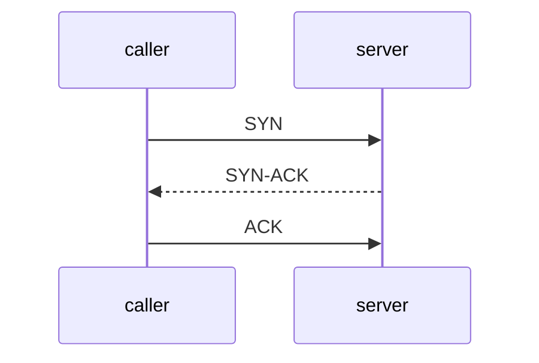

# Diagrams in lessons

A course guide (a Markdown file in the course repository) can contain diagrams. A diagram is written as text, in a
fenced code block tagged `mermaid`, and the lesson page draws it:

````markdown

````

The syntax is [Mermaid](https://mermaid.js.org/)'s. GitHub draws the same block when the file is read there.

## Why text, and not image files

- **Nothing to publish.** The diagram is part of the guide, so `pnpm course:import` already carries it, and it is
  versioned with the lesson it explains.
- **Private courses need nothing more.** A diagram is lesson content: whoever may read the lesson sees it, and nobody
  else can reach it (docs/private-courses.md). An image file would need a place to live and its own access check.
- **It follows the theme.** Colours come from the site's tokens, so a diagram is right in light and in dark mode.

Image files were the other option considered: any drawing, exact to the pixel, served like lesson videos from the
media bucket (docs/lesson-videos.md). They cost a file to make and upload per diagram, and an image can't follow the
light and dark switch. Nothing here rules them out later for a drawing that text can't describe.

## How it works

| Part | Where |
|---|---|
| A block tagged `mermaid` becomes a diagram | `components/courses/lesson-markdown.tsx` (the `pre` component) |
| Drawing it | `components/courses/mermaid-diagram.tsx`, a client component |

- **The guide is still rendered on the server.** The diagram is the one piece that runs in the browser. The Mermaid
  library is downloaded only on a lesson that has a diagram, after the page has painted, and once for all the
  diagrams on the page.
- **Theme.** Mermaid's `base` theme is given the site's own colours and font, read from `<html>` (`--card`,
  `--secondary`, `--foreground`, `--muted-foreground`, `--input` and others in `app/globals.css`). When the theme
  switches, each diagram is drawn again.
- **Security.** Mermaid runs at its `strict` level: labels are sanitised, and a diagram can't carry scripts or click
  handlers.
- **Width.** A diagram shrinks to fit its box, down to 60% of the size it was drawn at (its 14px text is then about
  8px). One too wide for that scrolls sideways inside its own box, as tables and code blocks do. The page itself
  never scrolls sideways.
- **When it can't be drawn** (the text isn't a valid diagram, or the library didn't load), the lesson shows the
  block's source as a code block, with a line saying so.

## Writing diagrams that read well

- **Prefer tall to wide.** `flowchart TB` and sequence diagrams with two or three participants fit a phone. A long
  `flowchart LR` chain ends up scrolling.
- **Keep labels short.** A group's title that is wider than what it contains spills past its border.
- **Sequence diagrams** suit anything that happens over time between two or three parties. **Flowcharts with
  `subgraph`** suit architecture: a network, what sits inside what, and the paths between them.
- **Some pictures are better as text** in an ordinary code block: a number line, a table of bits, a packet capture.
  The page's code font, Geist Mono, has the box-drawing and block characters (U+2500 to U+259F) and `↑ ↓`. It does
  not have `→ ← ▶ ◀`, which come from another font with a different width and break alignment; draw arrows as
  `──>`.
- **Check a new diagram on the page**, in both themes and at phone width, before publishing the lesson.
